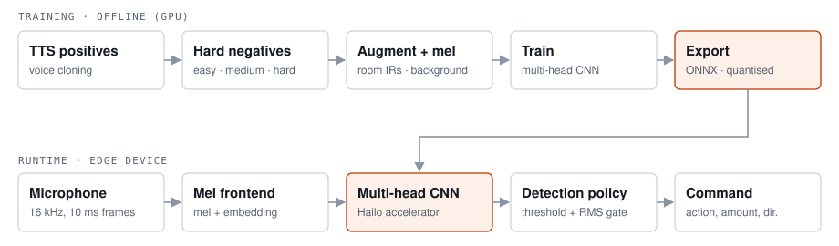

# Multi-Head Neural Classifier for Spoken-Command Recognition

> **About this repository.** This is a write-up of an industry project I built as a Senior Data Scientist (Machine Learning and Robotics) at Infiswift Technologies. The source code is proprietary and not included. Client names and the exact command vocabulary are omitted.

An always-on model that recognises short spoken commands for a robot and runs on a **Hailo edge-AI accelerator**. Each command is a combination of an **action**, an **amount** and a **direction**, and a custom multi-head CNN predicts all three from a live audio stream at **about 300 ms detection latency**. A full speech recogniser is not needed in the loop.

The hard part is safety. In a factory, a false trigger moves a real robot, so the model has to reject near-misses and background speech. That made this mostly a data problem.

**Role:** Lead and sole developer

**Stack:** Python · PyTorch · ONNX · quantisation · Hailo Edge AI · TTS voice cloning · NumPy

---

## Architecture

## How it works

### Model
- **Architecture.** A custom multi-head CNN on top of a mel-spectrogram front end and a pretrained audio embedding model.
- **Multi-head output.** Separate heads for the **action**, the **amount** and the **direction**, so commands are recognised as combinations rather than one fixed list of phrases.

### Dataset
- **Built from scratch.** Positives were synthesised with TTS voice cloning, using reference speakers from multi-speaker English and Japanese corpora for speaker diversity.
- **Graded negatives.** Easy, medium and hard negatives plus near-miss phrases, so the model doesn't fire on similar-sounding speech.
- **Real-world negatives.** Environmental sounds and microphone recordings from the deployment environment.
- **Augmentation.** Room impulse responses and background audio.
- **Reproducible runs.** A stage-based layout (`samples → dataset → features → model → eval`), so every training run traces back to the data it used.

### Edge deployment
- **Export.** The trained model is exported to ONNX, quantised, and deployed on a Hailo accelerator for real-time, on-device inference. Calibration data is taken from the same augmented training set.
- **Streaming runtime.** Live audio is processed continuously in 10 ms frames. A lean native mel front end removes heavy dependencies from the device image.

### Evaluation
- Scoring uses the same detection policy as the deployed runtime (thresholds plus energy gating).
- Continuous real-world audio is recorded to find false triggers that clip-level metrics miss.
- Latency benchmarks cover the front end and the end-to-end runtime.

## Results
| Metric | Value |
|---|---|
| Detection latency (continuous live audio) | **~300 ms** |
| Deployment | Quantised ONNX model on a Hailo edge-AI accelerator |
| Outputs | Action, amount and direction from one model |

## What I learned
Data was the bottleneck, not the model. How I designed the hard negatives and near-misses mattered more than any architecture change, and testing on continuous real-world audio exposed failures that clip-level metrics hid. Building datasets carefully is a skill I expect to use directly in learning robot policies from demonstrations.

---

Full portfolio: [rahulg-infiswift.github.io](https://rahulg-infiswift.github.io/)
